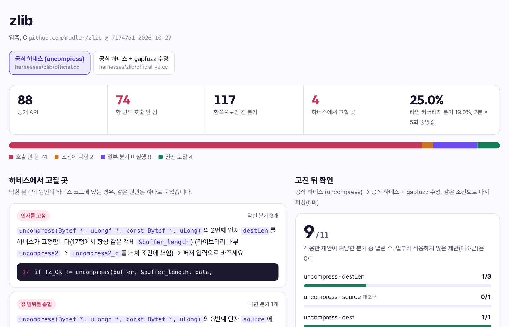

# gapfuzz

**퍼징 하네스가 놓친 코드를 찾아 그 원인이 된 하네스 코드의 줄과 인자를 짚고, Claude API로 하네스를 고친 뒤, 정말 열렸는지 검증하는 도구**

C/C++ · libFuzzer · llvm-cov · clang AST · Claude API · 정보보호프로젝트2 (2026 가을) 팀 프로젝트

```
 진단 (analyze)          →  수정 (llmfix)              →  검증 (verify, triage)        →  장시간 실험 (exp.py)
 막힌 분기와 그 원인이        gapfuzz의 제안을 Claude가       고친 하네스로 다시 퍼징해          OSS-Fuzz 하네스와 1시간 × 10회,
 된 하네스의 줄·인자를 찾음    하네스 코드로 옮김              짚은 분기가 열렸는지,             24시간 나란히 돌려 비교
                                                         크래시가 누구 탓인지 확인
                              ↑______ 실패하면 이유를 돌려주고 다시 고치게 함 ______|
```

---

## 한눈에

OSS-Fuzz에 등록된 C/C++ 라이브러리 8개에 적용한 중간 결과입니다.

| | 결과 |
|---|---|
| **진단이 맞나** | 도구가 짚은 하네스 코드를 고치자 막혀 있던 분기 **79개 중 67개**가 열림. 일부러 안 고친 제안(대조군)은 **0/9** |
| **반복해도 같은가** | 열린 67개는 5번 실행 **모두에서** 열림. 1~4번만 열린 "운 좋은" 분기는 0개 |
| **Claude가 고칠 수 있나** | 제안 하나씩 맡기면 **32개 중 31개** 통과. 라이브러리마다 한꺼번에 맡기면 6개 모두 통과, 겨냥 분기 **71개 중 65개** 열림 |
| **오래 돌리면 되지 않나** | zlib에서 24시간 동안 막힌 분기 15개가 저절로 열렸지만, 도구가 하네스 탓으로 짚은 12개는 하나도 열리지 않음. 2분·1시간·24시간 진단의 고칠 곳 목록이 같음 (zlib, jsoncpp) |

장시간 실험(OSS-Fuzz 하네스 vs Claude 수정, 1시간 × 10회와 24시간)은 팀원이 나눠 진행합니다. TinyXML2도 같은 기준으로 다시 실험합니다. 방법은 [평가·재현 문서](evaluation/README.md)에 있습니다.

라이브러리별 분석 결과는 분석기 사이트(`site/index.html`, 내려받아 브라우저로 열기)에서 볼 수 있습니다.



## 왜 필요한가

퍼저는 입력을 바꿀 뿐이고, 무엇을 호출할지는 **하네스**가 정합니다. 하네스가 부르지 않거나 항상 같은 값만 넘기는 코드는 몇 년을 퍼징해도 열리지 않습니다.

기존 도구는 "무엇이 빠졌는지"까지는 알려 줍니다.

| 도구 | 알려 주는 것 |
|---|---|
| llvm-cov | 몇 번째 줄이 몇 번 실행됐나 |
| Fuzz Introspector | 어느 함수·분기가 막혔나, 새로 노릴 함수 |
| **gapfuzz** | 하네스의 **어느 줄, 어느 인자** 때문에 막혔나 → Claude로 고치고 → 고친 뒤 열렸나, 크래시는 누구 탓인가 |

예를 들어 TinyXML2 안의 `if (!doc)` 분기가 한 번도 참이 된 적이 없을 때, llvm-cov는 그 `if`가 막혔다고만 보여 줍니다. gapfuzz는 이렇게 알려 줍니다(실제 리포트).

> `XMLComment::ShallowClone(XMLDocument *) const`의 1번째 인자 `document`를 하네스가 고정합니다(161행에서 항상 같은 객체 `&doc`) → 퍼저 입력으로 바꾸세요 (같은 호출이 5개 구현 클래스에 영향: `XMLComment`, `XMLDeclaration`, `XMLElement`, `XMLText`, `XMLUnknown`)

그대로 고쳤더니 막혀 있던 분기 5개가 5번 실행 모두에서 열렸습니다. Claude에게 맡겨도 첫 시도에 5개 모두 열렸습니다.

## 무엇을 하나

| 기능 | 명령 | 하는 일 |
|---|---|---|
| 진단 | `analyze` | 공개 API마다 한 번도 안 불렸는지, 일부 분기만 실행됐는지, 끝까지 실행됐는지 분류 |
| 원인 추적 | `analyze` | 한쪽으로만 간 조건이 읽는 값을 매개변수·필드·라이브러리 내부 호출로 거슬러 올라가 하네스의 호출 지점까지 연결하고, "하네스에서 고칠 곳"을 제안 |
| LLM 수정 | `llmfix` | 고칠 곳을 Claude API가 하네스 코드로 옮김. 제안 하나씩(`--fix 1`) 또는 여러 개를 한 하네스에(`--fix 1,3,4`). 도구가 컴파일 → 퍼징 → 검증 → 크래시 귀속으로 검사하고, 실패하면 이유를 돌려주고 다시 고치게 함 |
| API 추가 | `llmops` | 하네스가 한 번도 부르지 않는 공개 API에 우선순위를 매기고(새로 실행될 수 있는 코드 양), 상위 API의 호출을 Claude API가 하네스에 추가. 도구가 컴파일 → 퍼징 → 그 API가 실제로 실행됐나 → 원래 호출이 유지됐나 → 크래시 귀속으로 검사. 라이브러리별 규칙 없이 모든 대상에 사용 |
| 검증 | `verify` | 고친 하네스로 같은 조건의 퍼징을 반복해, 막혀 있던 분기가 열렸는지 셈. 일부러 안 고친 제안은 대조군 |
| 크래시 귀속 | `triage` | ASan 리포트의 해제·할당·접근 위치로 하네스 실수인지 라이브러리 결함인지 가려 잘못된 버그 보고를 막음 |
| 장시간 실험 | `scripts/exp.py` | OSS-Fuzz 하네스와 고친 하네스를 1시간 × 10회(통계 검정), 24시간(시간에 따른 곡선)으로 비교 |

원인 판정 가운데 앞의 네 가지가 "하네스에서 고칠 곳"이 됩니다.

| 판정 | 뜻 | 예 |
|---|---|---|
| 인자를 고정 | 기본값·상수·항상 같은 객체를 넘김 | `ShallowClone(&doc)` |
| 설정 API를 안 부름 | 값을 바꾸는 API를 호출하지 않음 | `SetBOM` 미호출 → `HasBOM()` 항상 거짓 |
| 값의 범위를 좁힘 | 몇 개 값 중에서만 고르거나 null을 넘긴 적이 없음 | 공백 모드 2가지만 → PEDANTIC 분기 |
| 공개 API를 직접 안 부름 | 라이브러리 내부에서만 한 가지 방식으로 불림 | zlib `inflate`의 `flush` |
| 할당 실패 처리 | 메모리 할당이 실패해야 열리는 분기 (하네스로 못 엶) | `if (!ptr) return NULL` |
| 라이브러리 내부 | 입력 내용·내부 상태로 정해짐 (딕셔너리·시드로 열어야 함) | 큰 문자 참조 값 |

## 결과

아래는 모두 OSS-Fuzz 하네스 기준입니다.

### 진단 검증: 제안대로 고치면 열리나 (120초 × 5회)

| 라이브러리 | 종류 | 적용한 제안 | 열림 | 대조군 |
|---|---|---:|---:|---:|
| TinyXML2 (OSS-Fuzz) | XML, C++ | 6 | 8/8 | 0/2 |
| pugixml | XML, C++ | 3 | 29/33 | 0/1 |
| expat | XML, C | 3 | 6/7 | 0/1 |
| cJSON | JSON, C | 4 | 5/7 | 0/1 |
| jsoncpp | JSON, C++ | 2 | 6/8 | 0/1 |
| json-c | JSON, C | 4 | 4/5 | 0/2 |
| zlib | 압축, C | 3 | 9/11 | 0/1 |
| libyaml | YAML, C | – | 고칠 곳 0개 (공개 API 50개 중 44개를 아예 안 부름) | – |
| **합계** | | **25** | **67/79** | **0/9** |

모두 남이 쓴 **OSS-Fuzz 하네스**입니다. 안 열린 12개는 하네스로는 닿지 않는 분기와 도구의 오판입니다.

### Claude 수정

| 방식 | 결과 |
|---|---|
| 제안 하나씩 맡김 (60초 × 2회 검사, 최대 3번 다시 시도) | 32개 중 **31개 통과** (첫 시도 30개), 겨냥 분기 87개 중 79개 열림, 하네스 탓 크래시 0번 |
| 라이브러리마다 한꺼번에 맡김 → 팀 실험용 `official_llm` | 6개 라이브러리 모두 통과, 겨냥 분기 **71개 중 65개** 열림 (같은 제안을 사람이 고쳤을 때 59/71) |

실패한 1개(json-c `json_object_array_shrink`)는 열리면 라이브러리가 프로그램을 종료하는 분기라 하네스로 열 수 없는 곳이었습니다.
Claude가 고친 코드와 검사 기록은 `evaluation/artifacts/llm/`에 있습니다. 바꾼 줄마다 `// [gapfuzz-llm] 이유` 주석이 붙어 있습니다.

### 장시간 실험

| 라이브러리 | 비교 | 1시간 × 10회, 분기 (중앙값) | 24시간 × 1회, 분기 |
|---|---|---:|---:|
| pugixml, expat, cJSON, jsoncpp, json-c, zlib | OSS-Fuzz → Claude 수정 | `evaluation/results/` 참고 | `evaluation/results/` 참고 |
| TinyXML2 | OSS-Fuzz → Claude 수정 | 다시 실험 예정 | 다시 실험 예정 |

판정 정확도, 크래시 귀속 사례 등 자세한 수치는 [docs/DETAILS.md](docs/DETAILS.md)에 있습니다.

## 빠른 시작

실험 수치는 **Ubuntu 24.04 + clang 18.1.3**에서 냈습니다. 같은 숫자를 보려면 Docker를 쓰세요(Windows는 WSL + Docker, 자세한 순서는 [평가·재현 문서](evaluation/README.md)).

```bash
git clone https://github.com/gapfuzz/Gapfuzz.git gapfuzz
cd gapfuzz
docker build -t gapfuzz .
docker run --rm -it --cap-add SYS_PTRACE -v "$PWD":/work gapfuzz bash
python3 scripts/exp.py doctor          # 환경 점검 (컨테이너 안)
```

라이브러리 하나를 받아 OSS-Fuzz 하네스를 2분 돌리고, 하네스에서 고칠 곳을 보기:

```bash
python3 scripts/exp.py fetch zlib
python3 scripts/tgt.py build zlib official
python3 scripts/tgt.py repeat zlib official --trials 1 --secs 120
# 결과: out/targets/zlib/official/r1/gap/gap_report.html ("하네스에서 고칠 곳")
```

고칠 곳을 Claude에게 맡기고 검사하기 (API 키는 환경 변수로만):

```bash
export ANTHROPIC_API_KEY=...
python3 -m gapfuzz llmfix zlib official --list            # 고칠 곳 목록
python3 -m gapfuzz llmfix zlib official --fix 1,3,4       # 여러 제안을 한 하네스에
python3 -m gapfuzz llmops zlib --list                     # 호출 안 함 API 우선순위 (API 키 필요 없음)
python3 -m gapfuzz llmops zlib --top 10                   # 상위 10개의 호출을 Claude가 추가 → harnesses/zlib/official_ops.cc
# 결과: out/llm/zlib/official_fix1_3_4/report.md, best.diff
```

새 라이브러리는 `targets/<이름>.json` 설정 파일 하나와 하네스(`harnesses/<이름>/official.*`)만 있으면 같은 명령으로 돌릴 수 있습니다. 전체 명령은 [docs/DETAILS.md](docs/DETAILS.md#사용법)를 보세요.

## 확장 분석 (후보)

기존 판정은 그대로 두고, 아래에서 나온 것은 리포트의 "고칠 곳 후보"에 따로 넣는다. 자세한 내용과 한계는 [docs/DETAILS.md](docs/DETAILS.md)의 "확장 분석" 절.

- **호출 순서·상태** (`STATE`, `STATE_ORDER`): 조건이 읽는 필드를 바꾸는 다른 공개 API를 하네스가 안 부르거나, 부르는 순서가 안 맞음
- **콜백·설정 함수** (`CALLBACK`): 함수 포인터가 비어서 막힌 분기 → 등록 API를 안 부름. C 구조체 필드도 추적
- **실행 중 인자 값** (`python3 -m gapfuzz argtrace <라이브러리> <하네스>`): 호출 지점에서 실제 넘어간 값을 기록해 "고정" 판정의 근거로 사용
- **입력 탓 확인** (`python3 -m gapfuzz inputcheck <라이브러리> <하네스>`): 조건식에서 만든 딕셔너리를 넣고 다시 퍼징해, 열리는 분기를 입력 탓으로 확정
- **어서션**: 어서션 매크로 안의 분기는 따로 모으고 갭 집계에서 뺌
- **하네스 전체 기준** (`python3 scripts/tgt.py union <라이브러리>`, `python3 -m gapfuzz llmops <라이브러리> --union`): OSS-Fuzz 하네스가 여러 개인 라이브러리에서 커버리지를 합치고, 어느 하네스도 안 부르는 API만 골라 새 하네스 하나로 추가
- **호출 안 함 API 추가** (`python3 -m gapfuzz llmops <라이브러리>`): 모든 라이브러리에서 우선순위를 매기고 Claude가 호출을 추가, gapfuzz가 검사

## 팀 실험

라이브러리 6개를 **OSS-Fuzz 하네스 vs Claude가 고친 하네스**로 1시간 × 10회, 24시간 × 1회씩 나눠 돌립니다. 방법은 **[평가·재현 문서](evaluation/README.md)**에 있습니다.
Claude 하네스는 이미 저장소에 있어서 팀원은 API 키가 필요 없습니다. 라이브러리를 맡고(`claim`), 돌리고(`run`), 작은 결과 파일만 올리는(`submit`) 흐름이라 팀원끼리 git 충돌이 나지 않습니다.

## 프로젝트 구조

```
gapfuzz/          핵심 분석·수정·검증 코드
harnesses/        라이브러리별 기준·수정 하네스
targets/          라이브러리 소스와 빌드 설정
scripts/          빌드·퍼징·분석 및 평가 실행기
tests/            핵심 기능과 실제 크래시 테스트
docs/             상세 사용법과 설계 문서
site/             분석 결과 웹 뷰어
evaluation/       연구 평가와 재현 자료
  experiments/    장시간 실험의 제안·대조군 설정
  results/        1시간·24시간 실험의 정규화된 결과
  artifacts/      검증·통계·LLM 수정 기록
  labeling/       독립 라벨링 자료
  presentation/   발표 자료
```

라이브러리 소스(`third_party/`)와 퍼징 산출물(`out/`)은 저장소에 없습니다. `scripts/exp.py fetch`가 고정 커밋으로 받습니다.

## 한계

- 호출 순서·상태에 달린 분기(예: 노드를 트리에 붙이지 않은 채 문서를 비워야 열리는 분기)는 아직 원인을 짚지 못합니다.
- 원인을 잘못 묶는 경우가 있습니다. 새 라이브러리를 붙일 때마다 오판이 드러났고, 규칙을 더해 고쳐 왔습니다 ([사례](docs/DETAILS.md#expat-json-c-libyaml-2026-11-01-추가)).
- "열면 프로그램이 종료되는 분기"를 제안 단계에서 거르지 못합니다 (json-c `empty_slots < 0`).
- Claude는 제안 범위를 넘어 코드를 더 바꾸기도 합니다(예: zlib에서 `inflate`를 매 입력 직접 호출). 그래서 장시간 실험의 차이에는 이런 추가 수정의 효과도 섞일 수 있습니다. 바꾼 코드는 모두 `evaluation/artifacts/llm/combined/`에 diff로 남겼습니다.
- 판정 정확도의 정답은 도구를 만든 저희가 달았습니다. 팀원 독립 라벨링으로 다시 잴 예정입니다.
- 새 취약점은 아직 찾지 못했습니다.

## 팀

정보보호프로젝트2 · 정태영, 김지윤, 허원제, 이지현

## 라이선스와 출처

- 라이선스는 아직 정하지 않았습니다. 공개 전에 정할 예정입니다.
- `harnesses/*/official.*`은 각 라이브러리 또는 [OSS-Fuzz](https://github.com/google/oss-fuzz)의 퍼징 하네스를 가져온 것이며, 원래 라이선스를 따릅니다. `official_v2`, `official_llm`은 이를 고친 것입니다.
- `harnesses/include/fuzzer/FuzzedDataProvider.h`는 LLVM 프로젝트의 파일입니다 (Apache License 2.0 with LLVM Exceptions).
- 퍼징 딕셔너리(`dicts/`)는 OSS-Fuzz와 각 라이브러리 저장소에서 가져왔습니다.
